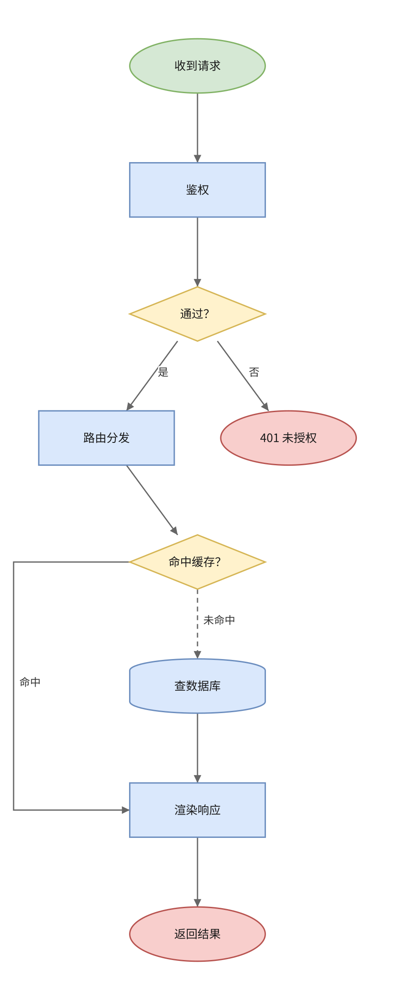

# dsh-drawio

**Let the agent draw real draw.io diagrams.** Install this and DeepSeek can write `.drawio` files
(flowcharts, org charts, ER boxes) straight into your workspace, and you can open them in an actual
draw.io editor inside the Harness sidebar — no copy-paste, no external upload.

[](LICENSE)
[](https://dsh-plugin.org/plugins/Nvoyo/dsh-drawio)



---

## Install

```bash
dsh plugin --profile web add @sorarisu/dsh-drawio
```

Or install straight from source:

```bash
dsh plugin --profile web add github:Nvoyo/dsh-drawio
```

Requires **DeepSeek Harness 0.2.x** and **Node.js >= 22.6**. Web profile only (the panel is a
browser surface).

After installing, restart DSH once so the client bundle loads. You get:

- a **图表 / Diagrams** icon in the sidebar,
- the **`drawio`** tool for the agent,
- a panel that opens every `.drawio` file in your workspace.

## What it changes for you

Ask the agent for a flowchart and it writes a file instead of ASCII art:

> 画一个登录流程图，密码错误就提示重试

The agent calls `drawio` with `action: "create"`, nodes, and edges. The result is
`docs/登录流程.drawio` — a real draw.io document you can open, drag boxes in, and save back.

The panel previews any diagram as SVG, and switches to draw.io's own editor on demand.

## The `drawio` tool

| action | what it does |
|---|---|
| `create` | build a new diagram from `nodes` + `edges` (layout is computed) |
| `edit` | add / update / remove cells in an existing file |
| `read` | return its nodes and edges as structured data |
| `export` | write a standalone SVG beside the diagram |
| `delete` | remove the file |
| `list` | find diagrams in the workspace |

```jsonc
{
  "action": "create",
  "path": "docs/login.drawio",
  "title": "登录流程",
  "nodes": [
    { "id": "start", "label": "开始", "role": "start", "shape": "ellipse" },
    { "id": "check", "label": "密码正确？", "shape": "diamond" },
    { "id": "ok",    "label": "进入首页" },
    { "id": "bad",   "label": "提示重试" },
    { "id": "end",   "label": "结束", "role": "end", "shape": "ellipse" }
  ],
  "edges": [
    { "from": "start", "to": "check" },
    { "from": "check", "to": "ok",  "label": "是" },
    { "from": "check", "to": "bad", "label": "否" },
    { "from": "ok",  "to": "end" },
    { "from": "bad", "to": "end" }
  ]
}
```

Shapes: `rect` `rounded` `ellipse` `circle` `diamond` `parallelogram` `hexagon` `cylinder`
`document` `cloud` `note` `actor` `database` `text`. Palettes: `default` `mono` `warm`.

## Permissions and external services

Be aware of exactly what this plugin touches:

- **Filesystem.** Reads and writes `.drawio` files **only inside registered workspaces**. Every path
  goes through one policy module; anything outside a workspace, or anything that is not `.drawio`,
  is refused with a reason rather than silently clamped.
- **HTTP routes.** Five endpoints under `/api/dsh-drawio` (`config`, `list`, `document`,
  `save`, `preview`). They accept **loopback sockets only**, and mutations additionally require a
  same-origin `Origin` / `Sec-Fetch-Site` signal, so a page on another site cannot drive your editor.
- **One external origin.** The embedded editor loads `https://embed.diagrams.net` in an iframe.
  That is draw.io's official embed build. In embed mode it has **no storage**: the document travels
  between your browser and this Host over `postMessage`, and is never sent to draw.io's servers.
  If the origin is unreachable, the panel falls back to the local SVG preview instead of breaking.
- **No telemetry, no analytics, no network calls** from the Host half.
- **No third-party npm dependencies.** The package is plain JavaScript, and it deliberately imports
  no `@deepseek-ai/*` package (see *Notes* below).

## Compatibility and known limits

- Web profile only; the client half targets the Harness Web UI.
- Only the **first page** of a multi-page `<mxfile>` is edited. Other pages are preserved byte-for-byte
  but not operated on.
- The SVG preview covers the 14 named shapes above. A diagram using exotic draw.io stencils still
  previews as boxes and edges; the embedded editor remains the exact view.
- Export produces **SVG only** — no rasterizer is bundled, so no PNG/PDF.
- The model's edits never re-render the page, so geometry you set by hand in the editor survives.

## Why it is written this way

```
model ──drawio tool──┐
                     ├── lib/store.js ── lib/drawio-xml.js   (one XML truth)
browser panel ─HTTP──┘                           │
                                          lib/drawio-svg.js  (preview)
                                          lib/edit.js        (surgical edits)
```

The model never writes XML; the editor never touches the filesystem. Both share one path policy and
one document normalizer, which is why an agent-written diagram opens in the editor and a human's drag
survives the agent's next edit.

## Development

```bash
node test/host.test.mjs     # tool, routes, path policy        (23 checks)
node test/client.test.mjs   # registration, render, protocol    (11 checks)
node test/e2e.test.mjs      # model ↔ panel round trip           (7 checks)
```

No build step, no dependencies. `test/` is excluded from the published tarball.

## License

**AGPL-3.0** © 2026 Nvoyo — see [LICENSE](LICENSE). Not affiliated with DeepSeek or draw.io.

```text
dsh-drawio-canvas — draw.io diagrams for DeepSeek Harness
Copyright (C) 2026  Nvoyo

This program is free software: you can redistribute it and/or modify it under
the terms of the GNU Affero General Public License as published by the Free
Software Foundation, either version 3 of the License, or (at your option) any
later version.
```

AGPL is a strong copyleft licence: if you run a modified version as a network service, you must
offer its source to those users. Using it locally, or forking it on GitHub, needs nothing beyond
keeping this notice.

---

**简体中文完整说明见 [README.zh.md](README.zh.md)** — 讲清了 Host/Client 两半每一层怎么写、
draw.io 的 `postMessage` 协议细节，以及开发时踩过的坑。
